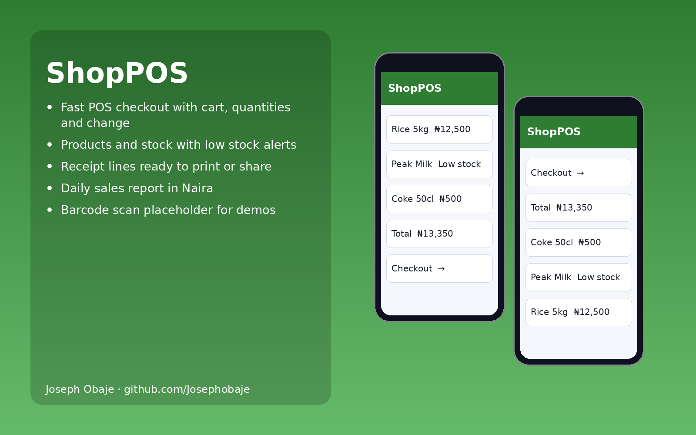

# ShopPOS: Flutter POS and Inventory App for Shops


**ShopPOS** is an offline Flutter portfolio demo by Joseph Obaje. It runs standalone with built-in mock Nigerian data — no server, account, API key or real money is involved. Fees, bills and prices are shown in Naira (₦) where relevant.



## Features

- Fast POS checkout with cart, quantities and change
- Products and stock with low stock alerts
- Receipt lines ready to print or share
- Daily sales report in Naira
- Barcode scan placeholder for demos
- Material 3 UI that works on Android, iOS and web
- Business logic kept in `lib/logic.dart` and covered by unit tests

## Tech stack

Flutter 3, Dart 3, Material 3 (no third-party packages required)

## Getting started

```bash
git clone https://github.com/Josephobaje/flutter-pos-inventory-app.git
cd flutter-pos-inventory-app
flutter pub get
flutter run          # Android, iOS or Chrome
flutter analyze
flutter test         # 4 tests: 3 logic unit tests + 1 widget test
```

## Project structure

```text
lib/
  main.dart    # app, theme and screens
  logic.dart   # models, mock data and business rules
test/
  logic_test.dart
  widget_test.dart
docs/hero.png  # 1600x1000 portfolio image
```

## Going live

Use this demo as the front end for a real system: persist data with a local database or your REST API, add authenticated roles per user type, and move payments to a server-verified gateway (for example Paystack) so secrets never ship in the app.

## Author

**Joseph Obaje**, Full Stack Developer (PHP, Python, Flutter) and Cybersecurity Specialist

- GitHub: [@Josephobaje](https://github.com/Josephobaje)
- LinkedIn: [joseph-obaje](https://www.linkedin.com/in/joseph-obaje)
- Email: [josephobaje264@gmail.com](mailto:josephobaje264@gmail.com)

## License

Released under the [MIT License](LICENSE). © 2026 Joseph Obaje
